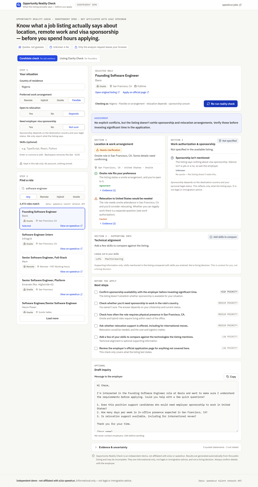
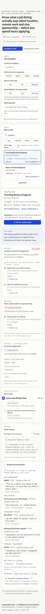
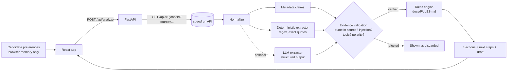
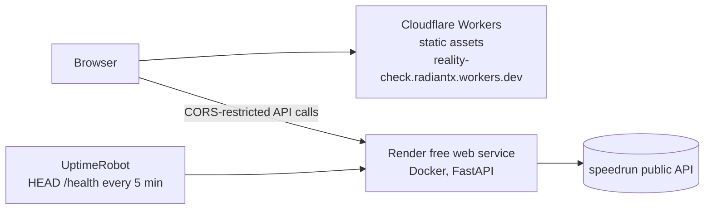

# Opportunity Reality Check

[](https://github.com/Radiant-O/opportunity-reality-check/actions/workflows/ci.yml)

**Know what a job listing actually says about location, remote work and visa sponsorship before you spend hours applying.**

| | |
|---|---|
| **Live demo** | **https://reality-check.radiantx.workers.dev** |
| **API** | https://opportunity-reality-check.onrender.com/health (interactive docs at [`/docs`](https://opportunity-reality-check.onrender.com/docs)) |
| **Demo video** | [`docs/demo/walkthrough.webm`](docs/demo/walkthrough.webm) |



Opportunity Reality Check is a small decision-support tool over **real job listings from the [a16z speedrun talent network](https://speedrun-talent-network.com/jobs) public API**. A candidate enters their situation (country, preferred work arrangement, openness to relocation, need for sponsorship). They pick a live listing and get an evidence-backed report:

- **What the listing explicitly states**, each statement quoted from the listing
- **What it leaves unstated** ("Not specified" is shown as unknown, never as "no")
- **Where it conflicts** with the candidate's preferences, via transparent deterministic rules
- **What to do next**: a short checklist and a copyable inquiry draft (nothing is ever sent)

A second, founder-facing panel, **Listing Clarity Check**, shows which candidate-critical details a listing communicates clearly, partially, or not at all.

> Independent demo, not affiliated with a16z or speedrun. Informational only, not legal or immigration advice.

**Demo recording:** [`docs/demo/walkthrough.webm`](docs/demo/walkthrough.webm) is a short silent screen recording of the running app against the live API. It covers entering preferences, analysing a listing that states sponsorship, a remote listing with unstated countries, and the Listing Clarity Check.

<p align="center"></p>

## Tech stack

| Layer | Technology |
|---|---|
| Frontend | React 18, TypeScript, Vite 6, Tailwind CSS 4, Vitest + Testing Library |
| Backend | Python 3.12, FastAPI, Pydantic v2, httpx, pytest, ruff |
| AI (optional) | Anthropic Claude via structured outputs, behind a quote-verifying validator |
| Hosting | Cloudflare Workers static assets (frontend), Render free web service in Docker (backend), UptimeRobot keep-alive |
| CI | GitHub Actions: lint, type-check, tests, extraction evals, build |

---

## Why

Job boards help people find roles, but not judge whether a role is realistic for them. A Nigerian engineer may be technically perfect for a San Francisco role, yet the listing may say nothing about sponsorship, relocation, or which countries "remote" covers. People lose hours preparing applications that hinge on facts they could have checked first. Incomplete listings also cost founders screening time.

## How it works



**Key design decisions**

1. **Deterministic first.** A regex/keyword extractor runs on every listing and quotes exact sentences. It is precise, free, instant and reproducible. On real speedrun listings it finds statements like *"We're happy to sponsor international candidates (e.g., STEM OPT, OPT, H1B, O1, E3)"*, *"works in person 4–5 days per week in San Francisco"* and *"Live between GMT-8 and GMT-5"*. It ignores perks like *"Company Sponsored Conferences"*.
2. **The LLM proposes; the validator and rules decide.** If `ANTHROPIC_API_KEY` is set, Claude extracts additional claims with structured output. **Every** claim, from either extractor, must pass validation:
   - Its quote must appear in the listing (whitespace and quote-character normalized).
   - All semantic checks run on the **full sentence** around the quote. That way, quoting "eligible for visa sponsorship" out of "This role is *not* eligible for visa sponsorship" can't flip its meaning.
   - For sponsorship, relocation and work arrangement, the deterministic reading of that sentence must agree with the claimed value. A favourable value is never accepted from a sentence containing a negation.
   - Regions must name a place mentioned in the sentence, skills must appear in the quote, and values must be canonical.
   - If the listing contains text addressed to AI or automated tools anywhere, every LLM claim from it is discarded. Favourable claims next to that text are distrusted too, and the user is told.

   Failed claims are shown to the user as "discarded" with a reason. Confidence scores are displayed as text with the caveat "confidence is not proof".
3. **Rules, not scores.** No single eligibility percentage. Each finding has a rule id (`docs/RULES.md`), a status, and links to the claims that support it.
4. **Unknown ≠ No.** "Not specified" and "Explicitly restricted" are visually and semantically distinct everywhere.
5. **Privacy by default.** No accounts, and no storage of preferences anywhere except React state. Logs contain only method, path, status and timing (a test asserts that preferences never reach logs). Uvicorn's access log, which would record IPs and query strings, is disabled. Client IPs are hashed in memory only for rate limiting.

## Repository layout

```
backend/                FastAPI service (Python 3.11+)
  app/speedrun.py       API client: fixed host, id validation, bounded retries, TTL cache
  app/normalize.py      Defensive parsing of speedrun records
  app/extraction/       deterministic.py, llm.py, validate.py, pipeline.py
  app/rules.py          Compatibility rules (see docs/RULES.md)
  app/recommend.py      Next steps, assessment sentence, draft inquiry
  app/clarity.py        Listing Clarity Check
  evals/                Labelled extraction cases + scored runner
  tests/                pytest (unit, API, validation, injection, live opt-in)
frontend/               React 18 + TypeScript + Vite + Tailwind v4
  src/components/       Preferences, job search, analysis panel, clarity check
docs/                   RULES.md, CASE_STUDY.md, API schema snapshot, demo
```

## Running locally

**Backend**

```bash
cd backend
python -m venv .venv && source .venv/bin/activate   # Windows: .venv\Scripts\activate
pip install -e ".[dev]"
uvicorn app.main:app --reload --port 8000
# optional: export ANTHROPIC_API_KEY=... to enable LLM extraction
```

**Frontend**

```bash
cd frontend
npm install
cp .env.example .env        # VITE_API_BASE_URL=http://localhost:8000
npm run dev                 # http://localhost:5173
```

No credentials are required. The speedrun API is public, and LLM extraction is optional.

### Configuration (backend env vars)

| Variable | Default | Purpose |
|---|---|---|
| `ANTHROPIC_API_KEY` | unset | Enables LLM extraction. Without it the app runs deterministic-only. |
| `LLM_MODEL` / `LLM_EFFORT` | `claude-opus-5-5` / `low` | Model and effort for extraction |
| `LLM_DAILY_CALL_CAP` | `300` | Hard cap on LLM calls per day (cost guard) |
| `LLM_MAX_INPUT_CHARS` | `12000` | Listing text sent to the model is truncated to this |
| `RATE_LIMIT_ANALYZE_PER_MIN` | `12` | Per-client limit for `/api/analyze` and `/api/listing-clarity` |
| `TRUST_X_FORWARDED_FOR` | `false` | Use the right-most `X-Forwarded-For` hop as the client IP. Enable only behind a proxy that appends it. |
| `CORS_ORIGINS` | localhost | Comma-separated allowed origins |
| `SPEEDRUN_SOURCE` | `opportunity-reality-check` | Attribution tag sent as `?source=` |

## API

| Method | Path | Notes |
|---|---|---|
| `GET` | `/health` | Status and whether LLM extraction is enabled |
| `GET` | `/api/jobs?q=&page=&workplace=` | Proxies `GET /api/v1/jobs` (50 per page) |
| `GET` | `/api/jobs/{id}` | UUID, 8-hex prefix or slug; strictly validated |
| `POST` | `/api/analyze` | `{job_id, preferences}` → full analysis (cached 10 min) |
| `POST` | `/api/listing-clarity` | `{job_id}` or `{description_text, location?, ...}` (deterministic only) |

Interactive docs at `/docs` when the server is running.

**Safeguards:**

- The backend talks to exactly one fixed host. Job ids are validated against a strict pattern, so the service can't be used to fetch arbitrary URLs.
- Request bodies forbid unknown fields; skills are capped at 20 and pasted text at 15k characters.
- Upstream calls have timeouts and bounded retries: two retries on 5xx and timeouts, none on 429.
- Per-client rate limits apply, and a spoofed `X-Forwarded-For` is ignored unless a trusted proxy is configured.
- Extraction (the only step that can call the LLM) is cached **per job**, so changing preferences never triggers new model calls. The LLM path also has an input cap, a concurrency cap and a daily cap.

## speedrun API integration

I verified the integration against the published OpenAPI spec (v1.4.0, snapshot in `docs/speedrun-openapi-snapshot.json`) before writing the client:

- Uses only `GET /api/v1/jobs` and `GET /api/v1/jobs/{id}`, and always passes `source=opportunity-reality-check`.
- Links users to the canonical `url` from the API (with our attribution), plus the official apply URL when present.
- Reads no undocumented fields and does no scraping. The API is read-only, and this app never attempts writes.
- Findings from probing the live API that shaped the client:
  - `workplace_type` arrives in mixed casing (`OnSite`, `Onsite`), so it is normalized.
  - Requests without a `User-Agent` get `403`, so the client sends a descriptive one.
  - Detail requests occasionally return `500` or time out, hence the bounded retries.

## Testing

```bash
cd backend && pytest -q                 # 163 tests, all external calls mocked
cd backend && python -m evals.run_evals  # extraction eval set, per-category precision/recall
cd backend && pytest -m live            # optional: real speedrun API
cd frontend && npm test                 # 36 Vitest + Testing Library tests
```

The backend tests cover:

- API success, malformed, missing and incomplete data; pagination; network failures, timeouts and 429s; bounded retries; caching
- id validation against path and URL injection
- sponsorship (stated, restricted and silent), conflicting preferences, ambiguous remote, and disagreement between the label and the description
- fabricated quotes, unsupported high-confidence claims, and prompt injection inside a listing, both against the validator and through a mocked LLM that obeys the injection
- LLM failure, refusal and daily-cap fallbacks
- determinism of the rules, rate limiting, and the absence of preferences from logs
- `tests/test_review_regressions.py`: every issue from an adversarial review of the backend, reproduced and pinned. Examples:
  - partial quotes that drop a negation
  - injection addressed to "automated screening tools"
  - "we no longer sponsor visas"
  - "relocation assistance is not available"
  - conference sponsorship and "visa-free" perks
  - unknown countries being treated as conflicts
  - spoofed `X-Forwarded-For`

The frontend tests cover loading, empty, error and success states, preference inputs, evidence lookup, copy-to-clipboard, and the clarity check.

**Evaluation set** (`backend/evals/cases.json`): 20 labelled listings across explicit restrictions, explicit support, silence, perk false-positives, negation traps, partial sponsorship, remote-with-region, time-zone-only remote, label/description conflicts, compound "hybrid" titles, citizenship requirements, case-by-case sponsorship, prompt injection, and salary/size traps. Each case states why it exists. The deterministic extractor currently scores 1.0 precision and recall on it, with zero unsupported claims. **Caveat:** these cases were written by the same author as the rules, so they are a regression gate, not an unbiased accuracy estimate. A fair estimate needs listings labelled by someone else (see the case study).

CI (`.github/workflows/ci.yml`) runs ruff, pytest, the eval set, the frontend type-check, the tests and the build. The live-API job runs too but never blocks.

## Deployment

The frontend is a static site and the backend is a single small container, with no database or Redis. The live demo runs entirely on free tiers.



**Backend: Render (free web service, Docker)**
1. In Render, choose **New → Blueprint** and select this repo (`render.yaml` builds `backend/Dockerfile`). Alternatively, create a **Web Service** with runtime Docker, root directory `backend` and health check `/health`.
2. Set `CORS_ORIGINS` to the frontend origin(s) and `TRUST_X_FORWARDED_FOR=true`.
3. Optionally add `ANTHROPIC_API_KEY` as a secret. The demo runs without one.

Pushes to `main` redeploy the backend automatically.

**Frontend: Cloudflare Workers (static assets)**

```bash
cd frontend
VITE_API_BASE_URL=https://opportunity-reality-check.onrender.com npm run build
npx wrangler deploy   # uses frontend/wrangler.jsonc, serves ./dist as an SPA
```

The backend only accepts browser requests from origins listed in `CORS_ORIGINS`, which must match exactly. If you deploy the frontend somewhere else, add that origin there.

**Keeping the free backend awake**

Render's free plan sleeps after 15 idle minutes, and the next request then takes about 50 seconds. A free UptimeRobot HTTP(s) monitor on `/health` every 5 minutes keeps it awake, and `/health` answers both `GET` and `HEAD`. If the backend does fall asleep, the frontend shows a "waking up" hint instead of failing silently.

## Limitations

- Deterministic extraction is precise but not exhaustive. Unusual phrasings fall through to "Not specified", which is honest but can under-report. The optional LLM path exists to raise recall without lowering precision.
- Country inference uses a small gazetteer. Ambiguous or multi-country locations become "unknown" rather than a guess.
- Whether a remote role abroad needs a visa depends on employment models that listings rarely state. The tool flags this rather than resolving it.
- In-memory caching and rate limiting assume a single instance. That's fine for a demo; use shared storage before scaling out.
- After deploying behind a proxy, confirm that the right-most `X-Forwarded-For` hop is the real client. If it is a proxy address, all users share one rate-limit bucket.
- Dev-only advisories: `npm audit` flags the Vitest 3 test runner (dev dependency, never shipped). `npm audit --omit=dev` is clean. Upgrading to Vitest 4 is blocked by an npm 10 resolver bug at the time of writing.

## Deviations from the original spec

- **LLM is optional rather than central.** The spec asks for deterministic parsing before introducing an LLM. On real speedrun listings deterministic extraction already finds the key statements precisely, so the LLM only adds recall and is validated like everything else. This also lets the public demo run without any API key or spend.
- **Listing Clarity Check never calls the LLM**, so anonymous pasted text can't drive model costs.
- **Technical alignment uses a curated skill vocabulary** rather than free-form extraction, to keep it predictable and clearly secondary.

See [`docs/CASE_STUDY.md`](docs/CASE_STUDY.md) for the product reasoning and a validation plan.
